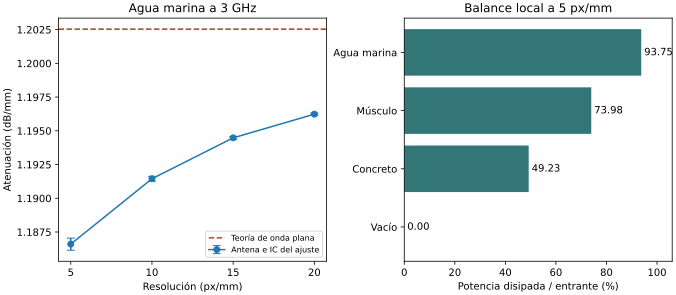

# Registro de verificación de la campaña de 3 GHz

## Archivos y reproducción

El índice enlaza los 61 resultados aceptados del plan final: 8 ondas planas, 41 láminas y 12 simulaciones de antena. `intentos.json` incluye además tres intentos interrumpidos de vacío con sus archivos parciales. Para aceptar un intento, el script comprueba el identificador, el medio, la malla, el espesor PML, la finalización del proceso, la estacionariedad registrada y los SHA-256 del código y del archivo de materiales. Las corridas históricas con otros parámetros se conservan por separado en el repositorio.

Desde la carpeta de la campaña, ejecutar `python analisis/verificar.py` con Python 3 y NumPy 2.x (verificado con 2.1.0). Las tablas se regeneran desde los JSON y CSV archivados. `sha256sum -c SHA256SUMS` permite verificar la copia descargada antes de regenerarla. Las potencias de antena están normalizadas en Meep, con longitud de referencia de 1 mm y amplitud de fuente sin calibrar en vatios.

| Tabla | Contenido |
|---|---|
| atenuacion.csv | Pendiente, IC condicional, sensibilidad al bloque y a la ventana, diagnóstico del ajuste y comparación con la teoría. Pendientes en dB/mm. |
| balance_anular.csv | Potencia entrante, saliente y disipada en el anillo. Residuo firmado como porcentaje de la entrada. |
| laminas.csv | Reflexión, transmisión, absorción por Joule, cierre y contraste analítico. Errores firmados en puntos porcentuales. |
| sensibilidad.csv | Pares de mallas y controles PML de antena. Diferencia relativa respecto al segundo caso. Campo vacío si el denominador es cero. |
| refinamiento_agua.csv | Cuatro resoluciones y prueba de orden aparente usando 5, 10 y 20 px/mm. La malla de 15 permite contrastar la interpolación. |

## Resultados de control

La figura se regenera con `python analisis/figura.py` y Matplotlib 3.8.4. Las barras de error del panel de atenuación representan el IC condicional del ajuste.

- **Onda plana.** Se recalculó la atenuación del flujo a partir de los campos complejos. A 5 px/mm la discrepancia respecto de la solución del medio homogéneo fue 0.1452 % en agua marina, 0.1036 % en músculo y 0.0099 % en concreto. En vacío la teoría predijo atenuación cero y el IC del control planar incluyó cero.
- **Láminas.** Se recalcularon T a partir del flujo transmitido, A por integración espacial de la pérdida de Joule y los tres coeficientes teóricos mediante las interfaces de una lámina. Se contrastó la R registrada por el simulador. La reconstrucción independiente de R desde campos requiere también la fase incidente de referencia. El máximo error absoluto de un coeficiente fue 0.1503 puntos porcentuales en los espesores reservados. El máximo cierre absoluto en los 41 casos fue 0.1087 puntos porcentuales (redondeo hacia arriba). Los espesores reservados prueban el modelo numérico bajo los mismos supuestos materiales.
- **Antena a 5 px/mm.** La fracción de la potencia entrante disipada en el anillo fue 93.7483 % en agua, 73.9835 % en músculo, 49.2285 % en concreto y cero en vacío. El máximo residuo absoluto de cierre fue 0.1455 % de la entrada. La geometría de cada anillo está archivada en milímetros. Estas fracciones describen exclusivamente ese volumen.
- **Atenuación aparente.** Se ajustó la pendiente negativa de 10 log10 del flujo radial compensado por r² frente a la distancia. A 5 px/mm la discrepancia respecto de la atenuación de onda plana fue 1.325 % en agua, 5.182 % en músculo y 0.499 % en concreto. En vacío la pendiente fue −0.000916 dB/mm y la disipación por Joule fue cero. El pequeño crecimiento del flujo compensado en la ventana limita la interpretación de esa pendiente como pérdida material.
- **Resolución.** Entre 5 px/mm y la malla más fina disponible, la pendiente cambió en magnitud relativa 0.805 % en agua (20 px/mm), 2.387 % en músculo y 0.025 % en concreto (10 px/mm). La fracción disipada cambió 0.099 %, 0.404 % y 0.025 % relativos, respectivamente. En cambio, la potencia entrante a 5 px/mm superó los valores de referencia en 23.9 %, 75.2 % y 50.9 %. La comparación común a 5 px/mm respalda tendencias de atenuación y fracciones locales. Las potencias absolutas siguieron sensibles a la malla. En vacío solo se completó una malla de antena.
- **Convergencia en agua.** La pendiente subió de 1.18660 a 1.19624 dB/mm entre 5 y 20 px/mm. El orden aparente calculado con 5/10/20 fue 0.018. Las diferencias entre esos refinamientos casi iguales hacen inestable la extrapolación al continuo. Las potencias presentaron un cambio de sentido en la serie de cuatro mallas. Se reporta sensibilidad observada. Un error de discretización absoluto o un orden asintótico fiable quedó indeterminado. Con dos mallas de músculo y concreto se cuantificó únicamente la diferencia entre las mallas disponibles.
- **Incertidumbre.** Se reprodujo el IC percentil del 95 % con 1 500 remuestreos de bloques de residuos y semilla 0. Se repitió con bloques de doble y cuádruple longitud para evaluar la correlación espacial. En agua a 5 px/mm el IC original fue [1.18615, 1.18705] dB/mm y con bloque cuádruple fue [1.18595, 1.18719]. La columna DW y la variación con la ventana ayudan a interpretar estos intervalos, condicionales a una corrida determinista. La discrepancia teórica y la sensibilidad a la malla se informan aparte. La variabilidad de muestras materiales quedó sin cuantificar.
- **Controles PML.** Los pares 2λ/3λ mantuvieron medio y resolución. La tabla documenta la variación con el espesor de la capa absorbente en cada magnitud. El control mide solo esa sensibilidad.

## Registro de ejecución

El diseño final de antena usó agua a 5/10/15/20 px/mm, músculo y concreto a 5/10 px/mm y vacío a 5 px/mm. Con respecto al plan parcial de 62 casos del commit 3990097, se sustituyó agua a 40 por 15 px/mm y se retiró músculo a 20 px/mm antes de su ejecución. Los registros de recursos por intento están en `proceso.json` y `resultado.json`. El límite configurado fue 5 GiB de memoria residente por simulación, con un solo hilo. La última reanudación se lanzó como servicio de usuario de WSL y se supervisó desde VS Code. Se incluye la configuración del espacio de trabajo al cierre.
